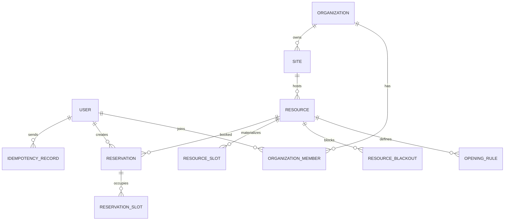

# NexaSlot — 智能资源预约与调度平台

NexaSlot 是一个面向会议室、场地等**独占型资源**的预约与调度平台。后端基于 FastAPI + SQLModel + MySQL，前端基于 React + TanStack Router/Query，V1 已跑通「资源发布 → 查询空闲时段 → 提交预约 → 查看订单 → 取消释放」的完整业务闭环，并用数据库事务保证并发预约的正确性。

## 界面预览

| 登录 | 资源中心 |
| --- | --- |
|  |  |

| 资源详情与选时段 | 我的预约 |
| --- | --- |
|  |  |

## V1 已实现

- **账号与鉴权**：注册、登录、JWT、个人资料、密码修改/找回（复用模板能力）。
- **多租户与 RBAC**：组织（租户）、成员邀请、`MEMBER` / `RESOURCE_MANAGER` / `ORG_ADMIN` 三级角色；所有业务接口均在服务端校验组织归属，防止越权与 IDOR。
- **场地与资源**：场地、资源（容量、设备标签、启停用）、设备条件与关键字筛选、分页。
- **开放规则**：按星期配置开放时段；支持临时停用（blackout），冲突时拒绝创建。
- **时间片与可用性**：30 分钟粒度、未来 14 天窗口，时间片幂等生成；查询某天全部时间片及 `AVAILABLE` / `BOOKED` / `CLOSED` / `PAST` 状态。
- **预约事务**：单事务 `SELECT ... FOR UPDATE` + 条件更新抢占时间片，唯一约束 `(resource_id, start_at)` 兜底；死锁有界重试。
- **请求幂等**：`Idempotency-Key` 同键同参返回原结果，同键异参返回 `IDEMPOTENCY_CONFLICT`。
- **订单与取消**：我的预约（即将开始/历史）、管理员订单视图、取消释放时间片；取消截止时间由服务端校验。
- **审计与健康检查**：预约/取消/管理操作写入 `audit_logs`；健康检查同时探测 MySQL 与 Redis。
- **测试**：61 个后端测试覆盖组织权限、资源规则、预约冲突、幂等、取消释放、跨租户隔离。

## 技术栈

| 层级 | 选型 |
| --- | --- |
| 后端 | Python 3.14、FastAPI、SQLModel、Alembic |
| 数据库 | MySQL 8.4（`utf8mb4`，UTC 存储） |
| 缓存/中间件 | Redis 7.4（V1 仅健康检查，不作为预约权威数据） |
| 前端 | React 19、TypeScript、Vite、TanStack Router / Query、Tailwind CSS、shadcn/ui |
| 鉴权 | JWT（OAuth2 密码模式） |
| 测试 | Pytest、Playwright |
| 本地依赖 | Docker Compose（MySQL + Redis + Mailpit） |

## 预约规则（V1 默认值，均可在环境变量中调整）

| 规则 | 默认值 | 配置项 |
| --- | --- | --- |
| 时间片粒度 | 30 分钟 | `BOOKING_SLOT_MINUTES` |
| 可预约窗口 | 未来 14 天 | `BOOKING_WINDOW_DAYS` |
| 最晚提前预约 | 开始前 15 分钟 | `BOOKING_MIN_LEAD_MINUTES` |
| 单次预约时长 | 30～240 分钟，整时间片 | `BOOKING_MAX_DURATION_MINUTES` |
| 取消截止 | 开始前 30 分钟 | `BOOKING_CANCEL_CUTOFF_MINUTES` |
| 资源占用 | 同一时间仅允许一笔有效预约（独占） | — |
| 支付 | 无支付，预约成功即 `CONFIRMED` | — |

## 数据模型



- `resource_slots` 是可用性的权威数据，唯一约束 `(resource_id, start_at)`；`current_reservation_id` 为空即未占用。
- `reservation_slots` 保留订单与时间片的历史关系；二者在同一事务内更新。
- 时间统一以 UTC 存库，接口输出带 `Z` 的 ISO 8601；场地时区用于本地时间换算。

## 快速开始

前置：`uv`、`bun`、Docker Desktop。

1. 启动 MySQL 与 Redis（宿主端口 `3307` / `6380`，避免与本机其他项目冲突）：

   ```bash
   docker compose up -d db redis
   ```

2. 配置并启动后端：

   ```bash
   cp .env.example .env
   cd backend
   uv sync
   uv run alembic upgrade head
   uv run python app/initial_data.py
   uv run fastapi dev --port 8001
   ```

3. 启动前端（另开终端）：

   ```bash
   cd frontend
   bun install
   bun run dev
   ```

4. 可选：写入演示组织与资源：

   ```bash
   cd backend
   uv run python scripts/seed_demo.py
   ```

| 入口 | 地址 |
| --- | --- |
| 前端 | http://localhost:5173 |
| API 文档 | http://localhost:8001/docs |
| 健康检查 | http://localhost:8001/api/v1/utils/health-check/ |
| Mailpit | http://localhost:8025 |
| Adminer | http://localhost:8080 |

默认管理员：`admin@example.com` / `changethis`。演示数据会创建组织「NexaSlot 演示组织」、场地「总部 A 座」及 3 个资源（星河会议室、云端会议室、静思舱），开放时间每天 09:00–21:00。

## 主要接口

| 方法 | 路径 | 说明 |
| --- | --- | --- |
| `GET` | `/api/v1/organizations/me` | 我加入的组织及角色 |
| `POST` | `/api/v1/organizations` | 创建组织（创建者成为 `ORG_ADMIN`） |
| `GET/POST` | `/api/v1/organizations/{org_id}/sites` | 场地列表/创建 |
| `GET/POST` | `/api/v1/organizations/{org_id}/resources` | 资源筛选/创建 |
| `GET/PATCH` | `/api/v1/resources/{id}` | 资源详情/编辑 |
| `POST` | `/api/v1/resources/{id}/opening-rules` | 覆盖开放规则 |
| `POST` | `/api/v1/resources/{id}/blackouts` | 临时停用 |
| `GET` | `/api/v1/resources/{id}/availability?date=` | 某天可用时间片 |
| `POST` | `/api/v1/reservations` | 创建预约（需 `Idempotency-Key`） |
| `GET` | `/api/v1/reservations/me` | 我的预约 |
| `POST` | `/api/v1/reservations/{id}/cancel` | 取消预约 |
| `GET` | `/api/v1/organizations/{org_id}/dashboard` | 组织数据看板 |

错误响应统一为 `{"detail": {"code": "...", "message": "..."}}`，常用错误码：`RESOURCE_NOT_FOUND`、`RESOURCE_INACTIVE`、`SLOT_UNAVAILABLE`、`BOOKING_RULE_VIOLATION`、`IDEMPOTENCY_CONFLICT`、`IDEMPOTENCY_KEY_REQUIRED`、`FORBIDDEN`。

## 测试

```bash
cd backend
uv run pytest
```

测试连接 `.env` 中配置的 MySQL，`conftest.py` 会自动创建超级管理员。请勿把测试指向生产库。

前端类型检查与构建：

```bash
cd frontend
bunx tsc -p tsconfig.build.json --noEmit
bun run build
```

CI 配置见 `.github/workflows/test-backend.yml`：启动 MySQL/Redis 容器 → 执行迁移 → 运行 Pytest。

## 目录结构

```text
backend/
  app/
    api/routes/       组织、场地、资源、预约、用户等路由
    core/             配置、数据库、Redis、时间、错误码
    services/         租户鉴权、时间片、预约事务、审计
    models.py         SQLModel 实体
    schemas.py        请求/响应模型
    alembic/          数据库迁移
  scripts/            初始化与演示数据脚本
  tests/              后端测试
frontend/
  src/routes/         资源中心、资源详情、我的预约、看板、管理后台
  src/components/     资源卡片、组织切换、后台表格等
  src/client/         OpenAPI 自动生成客户端
compose.yml           MySQL / Redis / 后端 / 代理编排
```

## V1 不包含

自动候补、超时释放、Outbox/Worker、实时通知、Redis 缓存与分布式限流、LLM 预约助手、AI 调度与利用率预测。这些能力按 V2/V3 规划，详见开发任务清单。

## 开源说明

本项目基于 [fastapi/full-stack-fastapi-template](https://github.com/fastapi/full-stack-fastapi-template)（MIT License，版权归原项目作者）二次开发，保留其认证、工程脚手架与前端基础组件；业务模型、预约事务、租户权限与预约页面为 NexaSlot 新增。许可证全文见 `LICENSE`。

仓库：<https://github.com/gufancm/NexaSlot>
