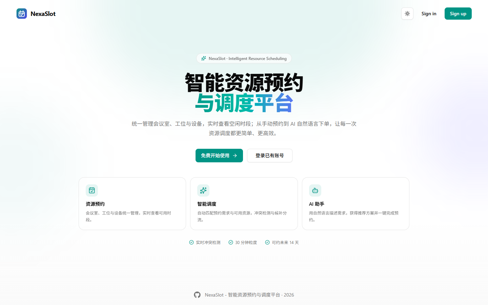
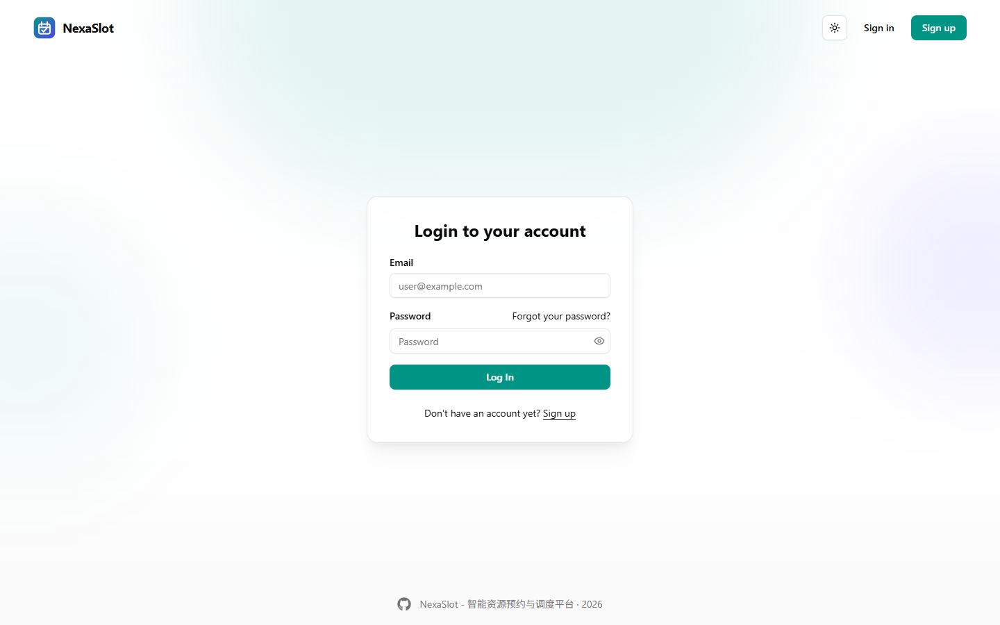
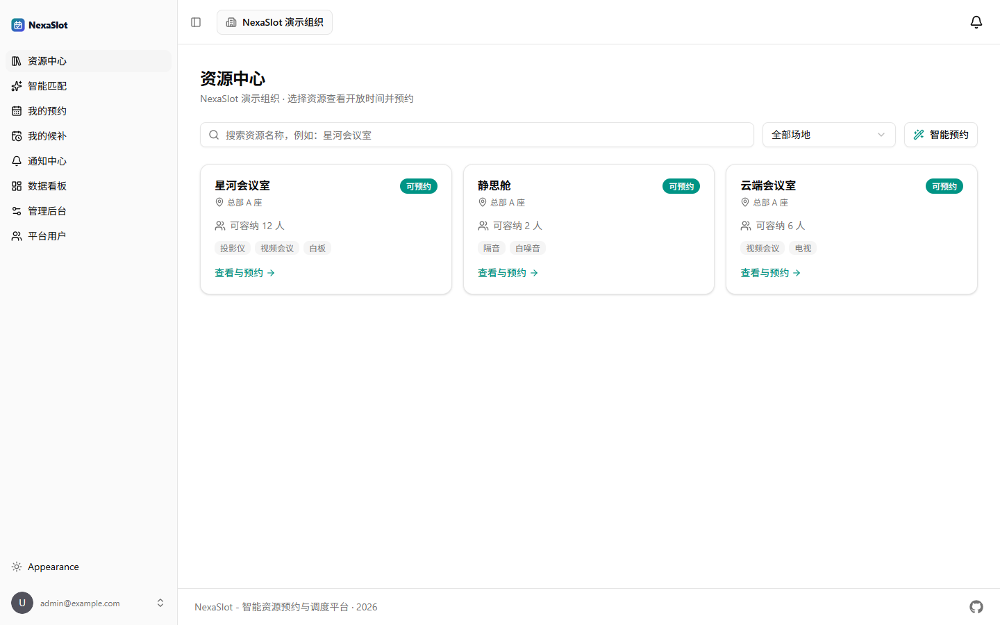
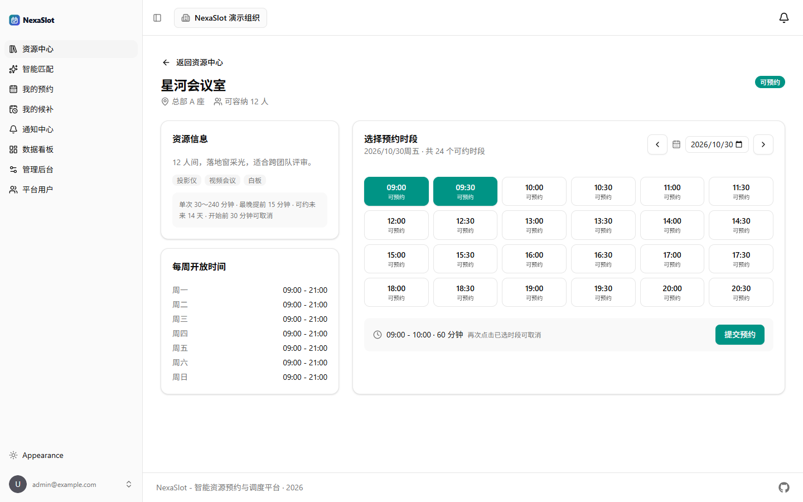
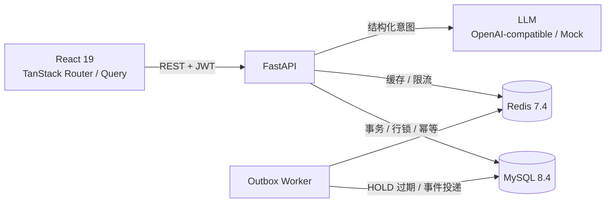

<div align="center">

# NexaSlot

**智能资源预约与调度平台**<br />
Intelligent Resource Booking & Scheduling Platform


[核心能力](#核心能力) · [技术架构](#技术架构) · [快速开始](#快速开始) · [部署](#部署) · [文档](#文档)

</div>



## 项目简介

NexaSlot 面向会议室、工位、设备等**独占型资源**，把资源发布、空闲查询、并发安全的预约、候补递补、站内通知和 AI 自然语言预约串成一条完整链路。

它不是只有一个“创建预约”接口的 CRUD Demo，而是围绕真实预约场景处理了几个关键问题：

- **冲突与并发**：MySQL 事务、行级锁、唯一约束和幂等键共同保证同一时段不会被重复占用。
- **资源释放后的分配**：候补队列、限时 HOLD、超时释放和自动递补形成闭环。
- **AI 的边界**：LLM 只负责理解自然语言，推荐来自数据库真实空闲时段，最终下单必须由用户确认。
- **多租户与权限**：组织隔离 + RBAC，资源、预约和管理接口都在服务端校验归属。

## 核心能力

| 模块 | 能力 |
| --- | --- |
| 资源与规则 | 场地、资源、容量、设备标签、启停用；按星期配置开放时间，支持临时停用 |
| 可视化预约 | 30 分钟时间片、未来 14 天窗口、连续时段选择，再次点击已选时段可取消 |
| 并发一致性 | `FOR SHARE` / `FOR UPDATE` 分级锁、条件更新、唯一约束、死锁重试、`Idempotency-Key` |
| 自动候补 | 同资源同时间窗口 FIFO；释放后创建限时 HOLD，确认、拒绝、超时自动递补 |
| 缓存与限流 | Redis Cache-Aside、版本号失效、single-flight、Lua Token Bucket 分布式限流 |
| 可靠异步 | MySQL Outbox + Worker，至少一次投递，通知按事件与用户幂等 |
| AI 智能预约 | 自然语言解析、真实资源匹配、用户确认后调用原预约接口 |
| 多租户 RBAC | 组织、成员邀请、`MEMBER` / `RESOURCE_MANAGER` / `ORG_ADMIN` |
| 可观测性 | 请求 ID、结构化日志、审计日志、运营指标、数据库与 Redis 健康检查 |

## 界面预览

| 登录页 | 资源中心 |
| --- | --- |
|  |  |



## 技术架构



- **API**：鉴权、租户校验、资源与预约规则、时间片事务、AI 推荐编排。
- **MySQL**：订单与时间片的唯一权威数据源，所有关键写操作在同一事务内完成。
- **Redis**：只承担缓存、限流与短期状态，不保存订单真相；Redis 故障时回源 MySQL。
- **Worker**：处理 Outbox 事件、候补 OFFER 过期和通知生成。
- **LLM**：只输出结构化意图，不直接创建订单，也不返回租户或资源 ID。

## 技术栈

| 层级 | 选型 |
| --- | --- |
| 后端 | Python 3.14、FastAPI、SQLModel、Alembic |
| 数据库 | MySQL 8.4（`utf8mb4`，UTC 存储） |
| 缓存 / 中间件 | Redis 7.4（Cache-Aside、Lua 限流、single-flight） |
| AI | OpenAI-compatible Chat Completions，可切换 Mock |
| 前端 | React 19、TypeScript、Vite、TanStack Router / Query、Tailwind CSS、shadcn/ui |
| 鉴权 | JWT（OAuth2 密码模式） |
| 测试 | Pytest、Playwright |
| 本地依赖 | Docker Compose（MySQL + Redis + Mailpit） |
| 生产部署 | Nginx 反向代理 + Certbot（Let's Encrypt）+ Docker Compose |

## 快速开始

### 方式一：Docker Compose（推荐体验）

前置：Docker Desktop 或 Docker Engine + Compose。

```bash
git clone https://github.com/gufancm/NexaSlot.git
cd NexaSlot
cp .env.example .env

# 修改 .env 中所有 changethis 占位值
docker compose up -d db redis
docker compose run --rm backend bash scripts/prestart.sh
docker compose up -d backend worker
docker compose exec backend python scripts/seed_demo.py
```

打开 <http://localhost:8001>。前端会随后端镜像一起构建，服务器不需要安装 Bun。

默认管理员：`admin@example.com` / `changethis`。演示数据会创建组织「NexaSlot 演示组织」、场地「总部 A 座」以及 3 个资源。**生产环境必须修改默认密码。**

### 方式二：本地开发

前置：`uv`、`bun`、Docker Desktop。

```bash
# 终端 1：启动依赖
docker compose up -d db redis

# 终端 2：初始化并启动后端
cp .env.example .env
cd backend
uv sync
uv run alembic upgrade head
uv run python app/initial_data.py
uv run python scripts/seed_demo.py
uv run fastapi dev --port 8001

# 终端 3：启动 Worker
cd backend
uv run python -m app.worker

# 终端 4：启动前端
cd frontend
bun install
bun run dev
```

| 入口 | 地址 |
| --- | --- |
| 前端 | <http://localhost:5173> |
| API 文档 | <http://localhost:8001/docs> |
| 健康检查 | <http://localhost:8001/api/v1/utils/health-check/> |
| Mailpit | <http://localhost:8025> |
| Adminer | <http://localhost:8080> |

## 账号与组织

项目采用**邀请制组织模型**：

- 注册只会创建账号，不会自动创建组织。
- 加入已有组织：管理员在「管理后台 → 成员」输入已注册邮箱邀请。
- 新建组织：登录后在空状态创建组织，创建者自动成为 `ORG_ADMIN`。
- 角色包括 `MEMBER`、`RESOURCE_MANAGER`、`ORG_ADMIN`，资源管理与成员管理权限不同。

## 配置

完整配置见 [`.env.example`](.env.example)。生产环境至少要修改：

| 变量 | 说明 |
| --- | --- |
| `SECRET_KEY` | JWT 签名密钥，必须替换 |
| `FIRST_SUPERUSER` / `FIRST_SUPERUSER_PASSWORD` | 初始管理员账号，必须替换密码 |
| `MYSQL_ROOT_PASSWORD` / `MYSQL_PASSWORD` | MySQL 密码 |
| `DATABASE_URL` | 后端连接 MySQL 的地址 |
| `REDIS_URL` | Redis 地址，用于缓存与限流 |
| `LLM_PROVIDER` | `mock`（默认）或 `openai` |
| `LLM_API_KEY` | 使用 OpenAI-compatible 服务时填写，禁止提交真实密钥 |
| `LLM_BASE_URL` / `LLM_MODEL` | 兼容接口地址与模型名 |
| `BOOKING_*` | 时间片粒度、预约窗口、最晚提前时间、取消截止时间 |

## 预约规则

| 规则 | 默认值 | 配置项 |
| --- | --- | --- |
| 时间片粒度 | 30 分钟 | `BOOKING_SLOT_MINUTES` |
| 可预约窗口 | 未来 14 天 | `BOOKING_WINDOW_DAYS` |
| 最晚提前预约 | 开始前 15 分钟 | `BOOKING_MIN_LEAD_MINUTES` |
| 单次预约时长 | 30～240 分钟，整时间片 | `BOOKING_MAX_DURATION_MINUTES` |
| 取消截止 | 开始前 30 分钟 | `BOOKING_CANCEL_CUTOFF_MINUTES` |
| 资源占用 | 同一时间仅允许一笔有效预约 | — |
| 支付 | 无支付，预约成功即 `CONFIRMED` | — |

## 测试与性能

后端测试：

```bash
cd backend
uv run pytest
uv run ruff check .
uv run ruff format --check .
```

当前包含 162 个后端测试，覆盖组织权限、预约冲突、幂等、取消释放、候补、并发锁竞争、Outbox 租约/重试与 AI 解析。测试连接 `.env` 中的数据库，请勿指向生产库；运行后可用 `scripts/cleanup_test_data.py` 清理测试组织与账号。

前端检查与 E2E：

```bash
cd frontend
bunx tsc -p tsconfig.build.json --noEmit
bun run build

# Windows PowerShell；本机 Chrome
$env:PLAYWRIGHT_CHANNEL='chrome'
bunx playwright test --workers=1
```

性能基线（10 用户、20 资源、20 秒可用性读负载）：缓存命中率 **96.94%**，P95 **22ms vs 40ms**，MySQL `Com_select` **-39.7%**。详见 [V2 性能报告](docs/v2/performance/report.md)。

## 项目结构

```text
backend/
  app/
    api/routes/       组织、场地、资源、预约、候补、匹配、通知、运维接口
    ai/               意图解析、LLM 客户端、推荐编排
    cache/            Cache-Aside 与资源版本化失效
    core/             配置、数据库、Redis、时间与错误码
    services/         预约事务、候补、分配、Outbox、资源匹配
    alembic/          数据库迁移
    worker.py         HOLD 过期与 Outbox Worker
  tests/              后端测试
frontend/
  src/routes/         首页、资源中心、资源详情、预约、候补、匹配、后台
  src/components/     资源卡片、智能预约弹窗、组织切换、通知铃铛等
  src/client/         OpenAPI 自动生成客户端
docs/
  v2/                 V2 架构、迁移、测试与性能报告
  v3-lite/            V3 架构、评测与演示清单
compose.yml           MySQL / Redis / 后端 / Worker 编排
compose.deploy.yml    Nginx / Certbot 与生产部署覆盖配置
deploy/nginx/         Nginx 镜像、首次启动证书与反向代理模板
```

## 部署

生产部署建议使用 Linux 服务器、Docker Engine 与已解析到服务器的域名。完整步骤见 [deployment-docker-compose.md](deployment-docker-compose.md)。

```bash
export DOMAIN=nexaslot.example.com
export CERTBOT_EMAIL=admin@example.com
export PROJECT_NAME=NexaSlot
export FIRST_SUPERUSER=admin@example.com

# 在 .env 或当前 shell 中设置 MYSQL_ROOT_PASSWORD、MYSQL_PASSWORD、
# SECRET_KEY、FIRST_SUPERUSER_PASSWORD

docker compose -f compose.yml -f compose.deploy.yml build
docker compose -f compose.yml -f compose.deploy.yml run --rm backend bash scripts/prestart.sh
docker compose -f compose.yml -f compose.deploy.yml up -d

# 首次申请证书；Nginx 会先以临时自签名证书启动并完成 HTTP-01 校验
docker compose -f compose.yml -f compose.deploy.yml run --rm --entrypoint certbot certbot certonly \
  --webroot -w /var/www/certbot -d "$DOMAIN" \
  --email "$CERTBOT_EMAIL" --agree-tos --no-eff-email
docker compose -f compose.yml -f compose.deploy.yml exec nginx nginx -s reload
```

MySQL、Redis、证书分别保存在 `app-db-data`、`app-redis-data`、`certbot-conf` 卷中；`.env` 和数据库数据都不会进入 Git。MySQL、Redis 与后端不映射公网端口，只有 Nginx 暴露 `80/443`。

## 版本演进

| 版本 | 重点 |
| --- | --- |
| V1 | 预约闭环、多租户 RBAC、并发一致性、审计 |
| V2 | 自动候补、Outbox Worker、Redis 缓存与限流、资源匹配 |
| V3 Lite | 自然语言预约、真实资源推荐、用户确认后下单 |

## 设计边界

- 候补 FIFO 仅承诺同一资源 + 完全相同时间段；跨资源全局排队不在当前范围。
- Outbox 为至少一次语义，通知通过唯一键幂等，不承诺外部通知恰好一次。
- Redis 故障时缓存回源、限流默认降级放行，MySQL 事务仍是订单唯一权威。
- 通知中心使用轮询，暂未实现 SSE 推送。
- AI 仅支持单轮会议室需求，不做多轮记忆、RAG、Agent 或自主下单。
- 当前资源模型没有楼层字段，楼层偏好不会硬性筛选；支付、动态定价不在本版本范围。

## 文档

- [V2 文档](docs/v2/README.md)：候补、Outbox、缓存、限流与多实例验收
- [V2 性能报告](docs/v2/performance/report.md)
- [V2 测试说明](docs/v2/testing.md)
- [V3 Lite 文档](docs/v3-lite/README.md)：自然语言预约、信任边界与评测
- [V3 架构](docs/v3-lite/architecture.md)
- [V3 评测报告](docs/v3-lite/evaluation.md)
- [V3 演示清单](docs/v3-lite/demo-checklist.md)
- [本地开发说明](development.md)
- [Docker Compose 部署](deployment-docker-compose.md)

## 开源说明

本项目基于 [fastapi/full-stack-fastapi-template](https://github.com/fastapi/full-stack-fastapi-template)（MIT License）二次开发，保留其认证、工程脚手架与前端基础组件；业务模型、预约事务、租户权限与预约页面为 NexaSlot 新增。许可证全文见 [LICENSE](LICENSE)。

仓库：<https://github.com/gufancm/NexaSlot>
