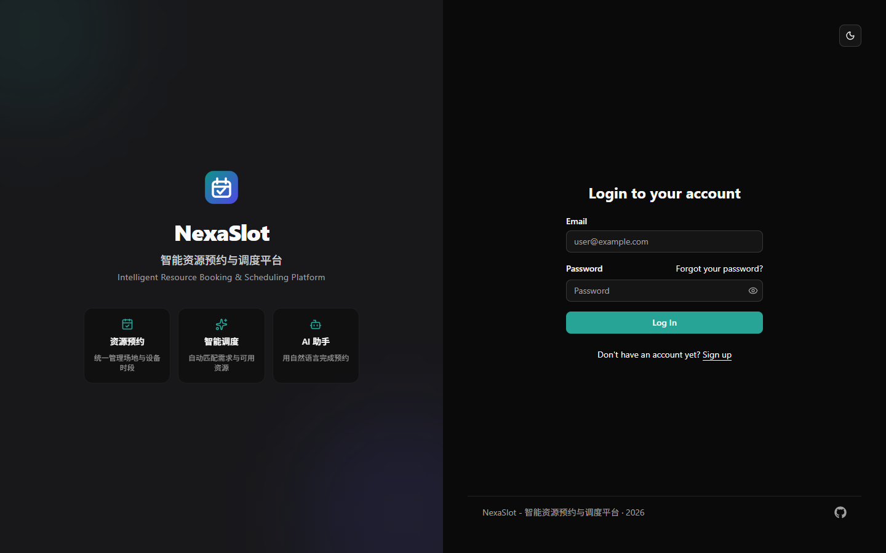
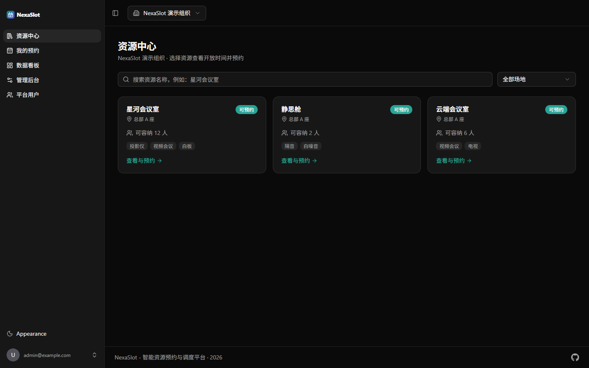
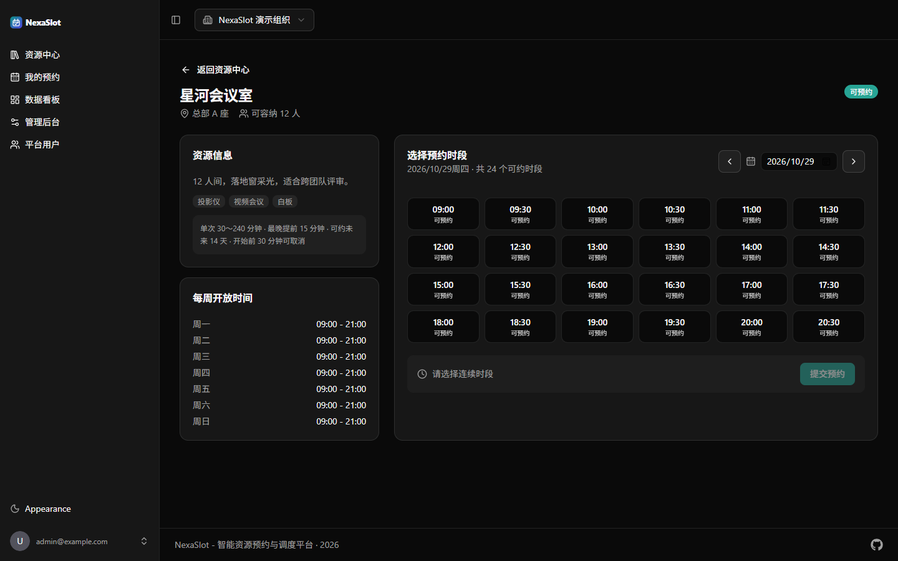
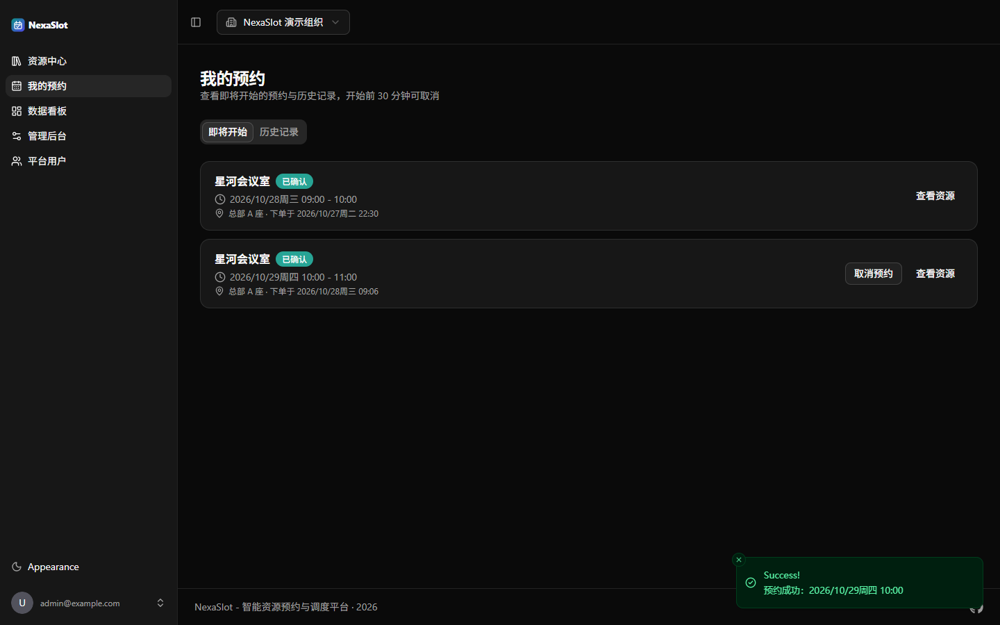
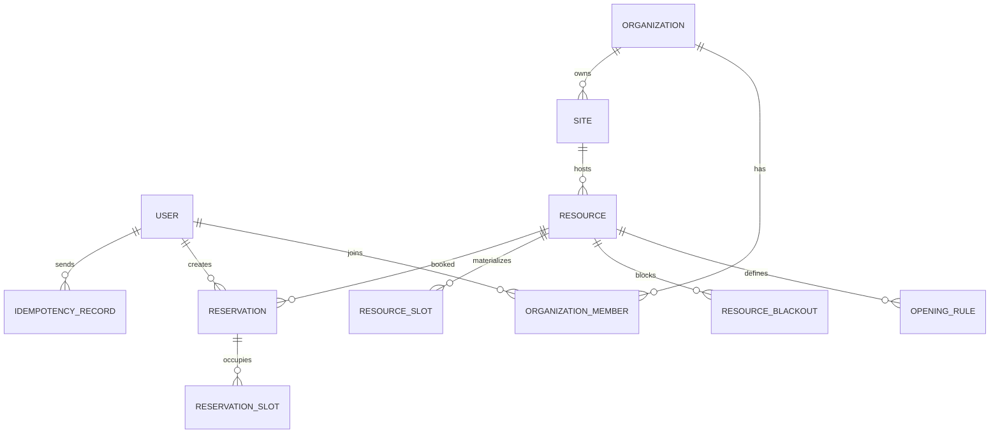

# NexaSlot — 智能资源预约与调度平台

NexaSlot 是一个面向会议室、场地等**独占型资源**的预约与调度平台。后端基于 FastAPI + SQLModel + MySQL，前端基于 React + TanStack Router/Query。V1 跑通「资源发布 → 查询空闲时段 → 提交预约 → 查看订单 → 取消释放」的完整闭环；V2 在此基础上补齐**自动候补、Redis 缓存与分布式限流、MySQL Outbox + Worker、确定性资源匹配、多实例与可复现压测**。

## 界面预览

| 登录 | 资源中心 |
| --- | --- |
|  |  |

| 资源详情与选时段 | 我的预约 |
| --- | --- |
|  |  |

## V1 已实现

- **账号与鉴权**：注册、登录、JWT、个人资料、密码修改/找回（复用模板能力）。
- **多租户与 RBAC**：组织（租户）、成员邀请、`MEMBER` / `RESOURCE_MANAGER` / `ORG_ADMIN` 三级角色；所有业务接口均在服务端校验组织归属，防止越权与 IDOR。
- **场地与资源**：场地、资源（容量、设备标签、启停用）、设备条件与关键字筛选、分页。
- **开放规则**：按星期配置开放时段；支持临时停用（blackout），冲突时拒绝创建。
- **时间片与可用性**：30 分钟粒度、未来 14 天窗口，时间片幂等生成；查询某天全部时间片及 `AVAILABLE` / `BOOKED` / `CLOSED` / `PAST` 状态。
- **预约事务**：单事务 `SELECT ... FOR UPDATE` + 条件更新抢占时间片，唯一约束 `(resource_id, start_at)` 兜底；死锁有界重试。
- **请求幂等**：`Idempotency-Key` 同键同参返回原结果，同键异参返回 `IDEMPOTENCY_CONFLICT`。
- **订单与取消**：我的预约（即将开始/历史）、管理员订单视图、取消释放时间片；取消截止时间由服务端校验。
- **审计与健康检查**：预约/取消/管理操作写入 `audit_logs`；健康检查同时探测 MySQL 与 Redis。
- **测试**：61 个 V1 后端测试覆盖组织权限、资源规则、预约冲突、幂等、取消释放、跨租户隔离。

## V2 已实现

- **自动候补与临时占位**：同一资源、完全相同时间段的 FIFO 队列；资源释放时在同一事务内创建有期限的 `OFFERED` HOLD；支持确认、拒绝、超时释放与自动递补。
- **可靠异步任务**：预约/取消与 `outbox_events` 同事务写入；Worker 使用 `SKIP LOCKED` + 租约领取，失败重试，通知按 `(event_id, user_id)` 幂等。
- **站内通知**：顶栏未读角标与通知中心；通知由 Outbox Worker 生成，前端轮询刷新。
- **Redis Cache-Aside**：可用性与资源详情缓存，资源版本号失效、single-flight 防击穿、Redis 故障回源 MySQL；命中率与回源量可观测。
- **分布式限流**：Redis Lua Token Bucket，预约/候补写接口按用户分桶，多实例共享配额；超限返回 `429` + `Retry-After`。
- **确定性资源匹配**：按人数、设备、场地、时段做硬约束过滤，再按容量/场地/时段软评分排序，返回可解释理由与替代方案。
- **可观测性**：`X-Request-ID`、结构化请求日志、`/api/v1/operations/metrics`（Outbox 积压、HOLD、候补、通知、缓存命中）。
- **多实例验收**：两实例共享 MySQL/Redis；限流不被放大，并发抢同一时段仅 1 笔成功。

实测结果（同一台机器、10 用户、20 资源、20 秒可用性读负载）：缓存命中率 **96.94%**，P95 **22ms vs 40ms**，MySQL `Com_select` **-39.7%**。详见 [V2 性能报告](docs/v2/performance/report.md)；架构、迁移与测试见 [V2 文档](docs/v2/README.md)。

## 技术栈

| 层级 | 选型 |
| --- | --- |
| 后端 | Python 3.14、FastAPI、SQLModel、Alembic |
| 数据库 | MySQL 8.4（`utf8mb4`，UTC 存储） |
| 缓存/中间件 | Redis 7.4（Cache-Aside、Lua 限流、single-flight；不作为预约权威数据） |
| 前端 | React 19、TypeScript、Vite、TanStack Router / Query、Tailwind CSS、shadcn/ui |
| 鉴权 | JWT（OAuth2 密码模式） |
| 测试 | Pytest、Playwright |
| 本地依赖 | Docker Compose（MySQL + Redis + Mailpit） |

## 预约规则（V1 默认值，均可在环境变量中调整）

| 规则 | 默认值 | 配置项 |
| --- | --- | --- |
| 时间片粒度 | 30 分钟 | `BOOKING_SLOT_MINUTES` |
| 可预约窗口 | 未来 14 天 | `BOOKING_WINDOW_DAYS` |
| 最晚提前预约 | 开始前 15 分钟 | `BOOKING_MIN_LEAD_MINUTES` |
| 单次预约时长 | 30～240 分钟，整时间片 | `BOOKING_MAX_DURATION_MINUTES` |
| 取消截止 | 开始前 30 分钟 | `BOOKING_CANCEL_CUTOFF_MINUTES` |
| 资源占用 | 同一时间仅允许一笔有效预约（独占） | — |
| 支付 | 无支付，预约成功即 `CONFIRMED` | — |

## 数据模型



- `resource_slots` 是可用性的权威数据，唯一约束 `(resource_id, start_at)`；`current_reservation_id` 为空即未占用。
- `reservation_slots` 保留订单与时间片的历史关系；二者在同一事务内更新。
- 时间统一以 UTC 存库，接口输出带 `Z` 的 ISO 8601；场地时区用于本地时间换算。

V2 增量表（迁移 `a7c41d9e2b10` → `b8e52f1c4d90`）：

- `booking_holds`：OFFER 临时占位，状态 `ACTIVE / CONSUMED / EXPIRED / RELEASED`。
- `waitlist_entries`：候补状态机；生成列唯一索引阻止同一用户对同一窗口重复排队。
- `notifications`：站内通知，唯一 `(event_id, user_id)` 保证 Outbox 重放幂等。
- `outbox_events`：事务内事件，Worker 按 `status + available_at` 领取。
- `resource_slots.current_hold_id`：与 `current_reservation_id` 通过 CHECK 约束互斥。

## 快速开始

前置：`uv`、`bun`、Docker Desktop。

1. 启动 MySQL 与 Redis（宿主端口 `3307` / `6380`，避免与本机其他项目冲突）：

   ```bash
   docker compose up -d db redis
   ```

2. 配置并启动后端：

   ```bash
   cp .env.example .env
   cd backend
   uv sync
   uv run alembic upgrade head
   uv run python app/initial_data.py
   uv run fastapi dev --port 8001
   ```

3. 启动 Worker（另开终端；V2 的 OFFER 过期与通知依赖它）：

   ```bash
   cd backend
   uv run python -m app.worker
   ```

4. 启动前端（另开终端）：

   ```bash
   cd frontend
   bun install
   bun run dev
   ```

5. 可选：写入演示组织与资源：

   ```bash
   cd backend
   uv run python scripts/seed_demo.py
   ```

| 入口 | 地址 |
| --- | --- |
| 前端 | http://localhost:5173 |
| API 文档 | http://localhost:8001/docs |
| 健康检查 | http://localhost:8001/api/v1/utils/health-check/ |
| Mailpit | http://localhost:8025 |
| Adminer | http://localhost:8080 |

默认管理员：`admin@example.com` / `changethis`。演示数据会创建组织「NexaSlot 演示组织」、场地「总部 A 座」及 3 个资源（星河会议室、云端会议室、静思舱），开放时间每天 09:00–21:00。

## 主要接口

| 方法 | 路径 | 说明 |
| --- | --- | --- |
| `GET` | `/api/v1/organizations/me` | 我加入的组织及角色 |
| `POST` | `/api/v1/organizations` | 创建组织（创建者成为 `ORG_ADMIN`） |
| `GET/POST` | `/api/v1/organizations/{org_id}/sites` | 场地列表/创建 |
| `GET/POST` | `/api/v1/organizations/{org_id}/resources` | 资源筛选/创建 |
| `GET/PATCH` | `/api/v1/resources/{id}` | 资源详情/编辑 |
| `POST` | `/api/v1/resources/{id}/opening-rules` | 覆盖开放规则 |
| `POST` | `/api/v1/resources/{id}/blackouts` | 临时停用 |
| `GET` | `/api/v1/resources/{id}/availability?date=` | 某天可用时间片 |
| `POST` | `/api/v1/reservations` | 创建预约（需 `Idempotency-Key`） |
| `GET` | `/api/v1/reservations/me` | 我的预约 |
| `POST` | `/api/v1/reservations/{id}/cancel` | 取消预约 |
| `GET` | `/api/v1/organizations/{org_id}/dashboard` | 组织数据看板 |

V2 新增接口：

| 方法 | 路径 | 说明 |
| --- | --- | --- |
| `POST` | `/api/v1/waitlist` | 加入候补（需 `Idempotency-Key`） |
| `GET` | `/api/v1/waitlist/me` | 我的候补与队列位置 |
| `DELETE` | `/api/v1/waitlist/{entry_id}` | 退出候补 |
| `GET` | `/api/v1/waitlist/offers/{hold_id}` | 查看 OFFER |
| `POST` | `/api/v1/waitlist/offers/{hold_id}/confirm` | 确认 OFFER → 预约 |
| `POST` | `/api/v1/waitlist/offers/{hold_id}/decline` | 拒绝 OFFER → 递补 |
| `GET` | `/api/v1/admin/waitlist` | 组织级候补队列 |
| `POST` | `/api/v1/scheduling/match` | 资源匹配 |
| `GET` | `/api/v1/resources/{id}/alternatives` | 替代资源/时段 |
| `GET/POST` | `/api/v1/notifications...` | 通知中心与已读 |
| `GET` | `/api/v1/operations/metrics` | 运营指标 |
| `GET/POST` | `/api/v1/operations/outbox...` | 失败事件与重试 |

错误响应统一为 `{"detail": {"code": "...", "message": "..."}}`，常用错误码：`RESOURCE_NOT_FOUND`、`RESOURCE_INACTIVE`、`SLOT_UNAVAILABLE`、`BOOKING_RULE_VIOLATION`、`IDEMPOTENCY_CONFLICT`、`IDEMPOTENCY_KEY_REQUIRED`、`FORBIDDEN`。

## 测试

```bash
cd backend
uv run pytest
uv run ruff check .
uv run ruff format --check .
```

当前共 **74 个后端测试**（V1 61 + V2 13）。测试连接 `.env` 中配置的 MySQL，`conftest.py` 会自动创建超级管理员；请勿把测试指向生产库。

前端类型检查与构建：

```bash
cd frontend
bunx tsc -p tsconfig.build.json --noEmit
bun run build
```

CI 配置见 `.github/workflows/test-backend.yml`：启动 MySQL/Redis 容器 → 执行迁移 → 运行 Pytest。

## 目录结构

```text
backend/
  app/
    api/routes/       组织、场地、资源、预约、候补、匹配、通知、运维路由
    cache/            Cache-Aside、资源版本化失效
    core/             配置、数据库、Redis、时间、错误码
    services/         租户鉴权、时间片、预约、候补、分配、Outbox、匹配
    models.py         SQLModel 实体
    schemas.py        请求/响应模型
    alembic/          数据库迁移
    worker.py         HOLD 过期与 Outbox Worker
  scripts/            初始化、演示数据、压测种子、多实例验收脚本
  locust/             Locust 场景（availability/hotspot/distributed/mixed）
  tests/              后端测试
frontend/
  src/routes/         资源中心、资源详情、预约、候补、匹配、通知、看板、管理后台
  src/components/     资源卡片、组织切换、通知铃铛、后台表格等
  src/client/         OpenAPI 自动生成客户端
compose.yml           MySQL / Redis / 后端 / 代理编排
```

## V2 边界与后续

- 候补 FIFO 仅承诺同一资源 + 完全相同时间段；跨时段、跨资源全局排队属后续版本。
- Outbox 为至少一次语义，通知通过唯一键幂等；不承诺外部通知恰好一次。
- Redis 故障时缓存回源、限流默认降级放行，MySQL 事务仍是订单唯一权威。
- 通知中心使用轮询，未实现 SSE 推送。
- LangGraph、LLM 自然语言预约、AI 运营问答、支付与动态定价属于 V3；本版本不包含。

## 开源说明

本项目基于 [fastapi/full-stack-fastapi-template](https://github.com/fastapi/full-stack-fastapi-template)（MIT License，版权归原项目作者）二次开发，保留其认证、工程脚手架与前端基础组件；业务模型、预约事务、租户权限与预约页面为 NexaSlot 新增。许可证全文见 `LICENSE`。

仓库：<https://github.com/gufancm/NexaSlot>
