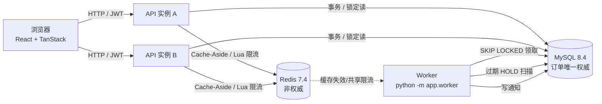
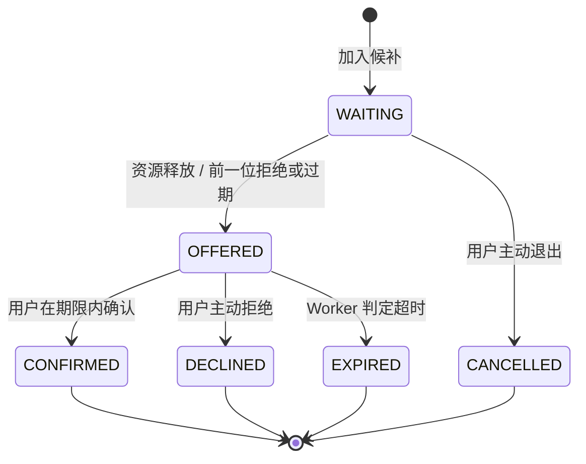
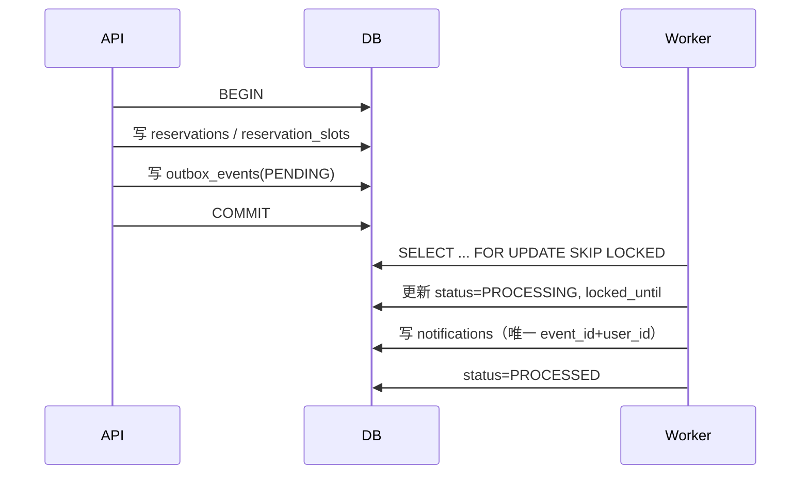

# V2 架构与一致性设计

## 1. 组件



- **MySQL 是唯一权威**：预约、取消、HOLD 确认都必须经过事务与行锁；缓存只影响读性能。
- **API 无状态**：JWT、数据库、Redis 共享，可水平扩展；多实例验收见 `testing.md`。
- **Worker 独立进程**：负责过期 HOLD 递补与 Outbox 通知，不与 HTTP 请求争用同一生命周期。

## 2. 数据模型增量

V2 新增四张表，并在 `resource_slots` 上增加一个占用指针：

| 表/列 | 作用 | 关键约束 |
| --- | --- | --- |
| `booking_holds` | OFFER 的临时占位（ACTIVE / CONSUMED / EXPIRED / RELEASED） | `ix_holds_status_expires`、`ix_holds_resource_start` |
| `waitlist_entries` | 候补队列及状态机 | `ix_waitlist_queue (resource,start,end,status,created_at,id)`；唯一索引 `uq_waitlist_active` 防止同一用户重复排队 |
| `notifications` | 站内通知 | 唯一 `(event_id, user_id)` 保证 Outbox 重放不重复 |
| `outbox_events` | 事务事件 | `ix_outbox_status_available`；`status/attempts/available_at/locked_until` |
| `resource_slots.current_hold_id` | 当前 HOLD 占用 | 与 `current_reservation_id` 互斥 |

### 数据库不变量

1. `(resource_id, start_at)` 唯一对应一条 `resource_slots`（V1 已有唯一约束）。
2. `CHECK ck_slot_single_owner`：`current_reservation_id` 与 `current_hold_id` 不能同时非空。
3. 已确认订单的所有时间片一致指向该订单；取消后指针必须清空。
4. 已消费、过期或释放的 HOLD 不再占用时间片。
5. 同一 HOLD 只能确认一次；重复确认返回冲突，不重复生成订单。
6. 同一队列窗口同时最多一个 OFFER。
7. Outbox 重复投递不影响以上任何不变量。

## 3. 事务边界与锁顺序

所有写路径统一采用以下顺序，避免交叉死锁：

```text
resource 行（SELECT ... FOR UPDATE）
  -> resource_slots 按 start_at 升序（SELECT ... FOR UPDATE）
  -> booking_holds / waitlist_entries 行
  -> 写 reservations / reservation_slots / outbox_events
```

| 场景 | 事务边界 | 关键动作 |
| --- | --- | --- |
| 创建预约 | 单事务 | 锁资源 → 锁时间片 → 校验空闲 → 写订单/关联/Outbox → 提交换缓存版本 |
| 取消预约 | 单事务 | 锁资源 → 锁时间片 → 释放指针 → **同事务**为下一位候补创建 HOLD |
| 加入候补 | 单事务 | 锁资源/时间片 → 校验确实不可用 → 写候补 + Outbox |
| 确认 OFFER | 单事务 | 锁资源/时间片/HOLD → 校验未过期 → 写订单 → HOLD 置 CONSUMED |
| 拒绝/过期 | 单事务 | 锁资源/时间片/HOLD → 释放 → 同事务递补下一位 |

**为什么释放时要同事务递补**：如果先提交“释放”，再异步创建 HOLD，新来的 HTTP 预约可能在这个窗口抢走时间片。V2 在取消事务内直接创建下一位 HOLD，保证队列优先。

## 4. 候补状态机



- 只有 `WAITING` 与 `OFFERED` 计入活跃队列；`active_flag` 生成列 + 唯一索引防止同一用户对同一窗口重复排队。
- `created_at` 使用 `DATETIME(6)`，FIFO 排序键为 `(created_at, id)`；秒级精度会让同秒写入退化为 UUID 随机序。
- `offer_expires_at` 由服务端/数据库时间判定，前端倒计时只用于展示。
- OFFER 有效期默认 10 分钟（`WAITLIST_OFFER_TTL_MINUTES`）。

## 5. 缓存设计（Cache-Aside）

```text
读：GET cache -> 命中返回
             -> 未命中：抢 single-flight 锁 -> 查 MySQL -> SET TTL
写：MySQL 事务提交 -> INCR 资源版本号 -> 旧缓存自然过期
```

- **版本化失效**：每次写入只 `INCR nexaslot:ver:resource:{id}`，缓存键包含版本号。无需枚举删除所有日期键，也避免删除与并发回填的竞态。
- **single-flight**：同一资源/日期重建只允许一个请求回源，其余等待 50ms 后重试缓存；仍未命中才回源，避免击穿。
- **降级**：Redis 连接失败时 `cache_*` 返回 `None/False`，请求回退 MySQL；写事务不受影响。
- **TTL**：可用性 60 秒、资源详情 300 秒；版本号变化后旧键不再被读取。
- **命中统计**：`nexaslot:stats:cache:hit/miss`，通过 `/operations/metrics` 暴露。

## 6. 分布式限流

- Redis Lua 脚本原子执行 Token Bucket：`HMGET tokens,ts` → 按毫秒补充 → 扣减 → `HSET` + `PEXPIRE`。
- 预约、候补写接口按 `user_id` 分桶；多实例共享同一 Redis 键，实例数不会放大配额。
- 超限返回 `429` + `Retry-After`，错误码 `RATE_LIMITED`。
- Redis 不可用时默认**降级放行**；只有显式开启 `RATE_LIMIT_FAIL_CLOSED_ON_WRITE=true` 才返回 503。这是为了避免限流组件故障拖垮核心预约。

## 7. Outbox 与 Worker



- 事件与业务写入同事务，避免“订单成功但通知丢失”。
- 领取使用 `SKIP LOCKED` + 租约，多个 Worker 可并行且不会重复占用同一事件。
- 失败指数退避，超过 `OUTBOX_MAX_ATTEMPTS` 转 `FAILED`，可经运维接口手动重试。
- 通知写入依赖唯一键，重放安全；语义是**至少一次**。

## 8. 确定性资源匹配

1. **硬约束**：组织/场地启用、资源启用、容量 ≥ 人数、必需设备全部包含、指定窗口内所有时间片空闲。
2. **软评分**：`0.5 × 容量契合 + 0.3 × 场地偏好 + 0.2 × 时段契合`，输出 0–100 分。
3. **可解释**：每个候选返回 `reasons`（容量、场地、空闲时段、设备）。
4. **稳定排序**：`(-score, resource.name, resource.id)`，同分结果可复现。
5. **替代推荐**：同资源未来 3 个可用日期 + 同组织其他可用资源。

匹配只读真实数据库，不调用 LLM，不生成不存在的资源。

## 9. 故障与降级

| 故障 | 行为 |
| --- | --- |
| Redis 不可用 | 缓存回源 MySQL；限流默认放行；预约正确性不受影响 |
| Worker 停止 | 预约/取消正常；OFFER 不自动过期、通知延迟，恢复后继续扫描 |
| API 实例重启 | 无本地状态；JWT/MySQL/Redis 共享，重启后继续服务 |
| 并发抢同一时段 | 行锁 + 条件更新 + 唯一约束兜底，仅一笔成功，其余 409 |
| Outbox 重复投递 | 通知唯一键去重；不影响订单与占用 |
| HOLD 过期未确认 | Worker 原子释放并递补下一位；重复确认返回冲突 |

## 10. 可观测性

- `request_context` 中间件为每个请求生成/透传 `X-Request-ID`，记录方法、路径、状态码、耗时。
- `GET /api/v1/operations/metrics` 提供：Outbox 待处理/失败/最老事件年龄、活跃/过期 HOLD、候补等待/已发 OFFER、确认订单数、未读通知、缓存命中/未命中/命中率。
- `GET /api/v1/operations/outbox/failed` 与重试接口用于故障排查。
- 业务冲突 `409` 与限流 `429` 不计为 `5xx`；压测报告单独统计。

