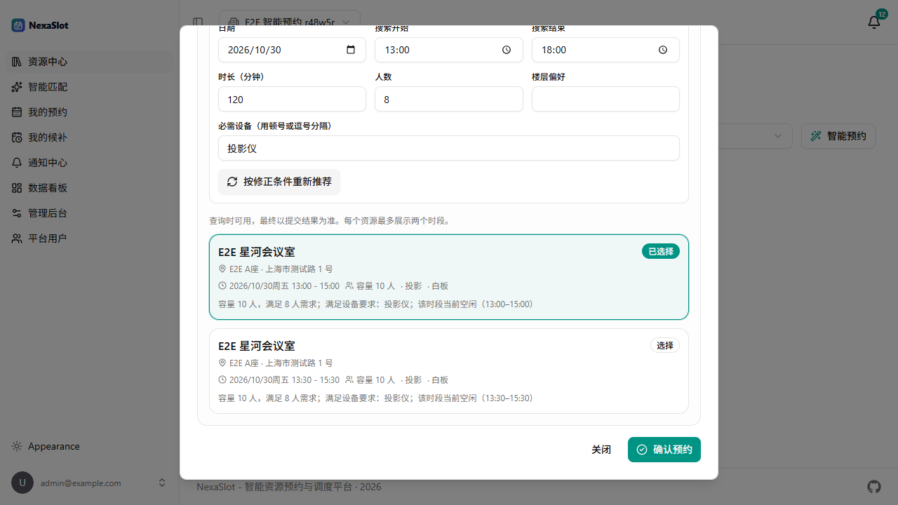

# NexaSlot V3 Lite｜智能预约

V3 Lite 在 V1/V2 之上增加一个**受控的自然语言预约助手**：用户用一句话描述需求，服务端解析条件、校验业务规则、复用 V2 确定性匹配服务返回真实可预约时段；只有用户点击“确认预约”后，才调用原有 `POST /api/v1/reservations` 创建订单。



## 交付范围

- 自然语言解析：日期、时间窗口、时长、人数、设备、楼层偏好。
- Pydantic 校验与缺失条件澄清：`needs_clarification`。
- 真实资源推荐：复用 `app.services.matching.match_resources`，不重新实现调度。
- 用户确认后预约：沿用 V2 `Idempotency-Key`、事务、409 冲突与订单查询。
- 降级：LLM 关闭/超时/非法响应时返回 `unavailable`，手动预约不受影响。

明确不包含：LangGraph、多 Agent、MCP、RAG、向量库、会话持久化、AI 专用数据表、LLM 直接写库或锁定时间片。

## 快速运行

### 1. 环境变量

根 `.env`（本地演示）：

```dotenv
AI_ENABLED=true
LLM_PROVIDER=mock
```

真实 OpenAI 兼容模型（示例，密钥只放后端）：

```dotenv
AI_ENABLED=true
LLM_PROVIDER=openai
LLM_API_KEY=sk-...
LLM_BASE_URL=https://api.openai.com/v1
LLM_MODEL=gpt-4o-mini
LLM_TIMEOUT_SECONDS=12
LLM_MAX_OUTPUT_TOKENS=512
LLM_MAX_RETRIES=1
```

其他配置：`RATE_LIMIT_AI_CAPACITY=5`、`RATE_LIMIT_AI_REFILL_PER_MINUTE=5`。修改 `.env` 后需要重启 API。

填写 Key 后先做一次单请求连通性检查（不会跑 40 条评测，避免多余费用）：

```powershell
cd backend
uv run python scripts/check_llm.py
```

默认模型为 `gpt-4o-mini`；如需更换，修改 `.env` 的 `LLM_MODEL` 并重启 API。

### 2. 启动

```powershell
# MySQL / Redis
docker compose up -d db redis

# API
cd backend
uv run fastapi dev --port 8001

# Worker（V2 候补/通知能力）
uv run python -m app.worker

# 前端
cd ../frontend
bun run dev
```

打开 <http://localhost:5173>，登录后在资源中心点击“智能预约”。

## API

### `POST /api/v1/ai/recommend`

```json
{
  "org_id": "b5689aad-bc93-4025-b871-897d07343a9d",
  "message": "明天下午，8个人，带投影仪，开两个小时",
  "site_id": null,
  "overrides": null
}
```

响应状态：

- `needs_clarification`：缺少日期/人数/时长等，返回 `missing_fields`。
- `suggestions`：返回 V2 查询得到的真实候选，附 `interpreted`、`assumptions`。
- `no_results`：硬约束无候选，引导放宽条件或手动预约。
- `unavailable`：AI 关闭或供应商不可用，原手动预约仍可使用。

推荐候选字段：`resource_id`、`resource_name`、`start_at`、`end_at`、`capacity`、`equipment`、`location`、`timezone`、`score`、`reason`。

确认预约仍调用：

```text
POST /api/v1/reservations
Header: Idempotency-Key: <稳定键>
Body: { resource_id, start_at, end_at }
```

## 信任边界

| 数据 | 来源 | 服务端处理 |
| --- | --- | --- |
| `org_id` / `site_id` | 当前登录会话 + 用户选择 | JWT + 组织成员校验，不信任 LLM |
| 日期/时间/人数/设备/楼层 | LLM 或 Mock 解析 | Pydantic + 业务规则校验 |
| 资源、容量、设备、空闲状态 | V2 数据库查询 | 只使用查询结果，不信模型生成事实 |
| 订单结果 | V2 预约事务 | 仅 `POST /reservations` 返回真实订单号 |

LLM 输出被限制在预约条件字段，明确禁止输出 `resource_id`、`org_id`、`user_id`、订单号或“已预约成功”。`required_equipment` 作为硬约束；楼层当前没有数据字段，只作为软偏好并写入 `assumptions`，不会虚构筛选。

## 测试与证据

- 后端：`138 passed`（V1 61 + V2 13 + V3 64）。
- 解析基线：40 条冻结中文样例，Mock 关键字段准确率 100%，详见 [evaluation.md](evaluation.md)。
- Playwright：6 项 V3 E2E，覆盖成功预约、澄清、无结果、AI 不可用、手动预约退路、409 冲突。
- 截图：[推荐](screenshots/smart-booking.png)、[确认成功](screenshots/smart-booking-confirmed.png)。

## 相关文档

- [架构与信任边界](architecture.md)
- [评测方法与结果](evaluation.md)
- [演示清单](demo-checklist.md)

