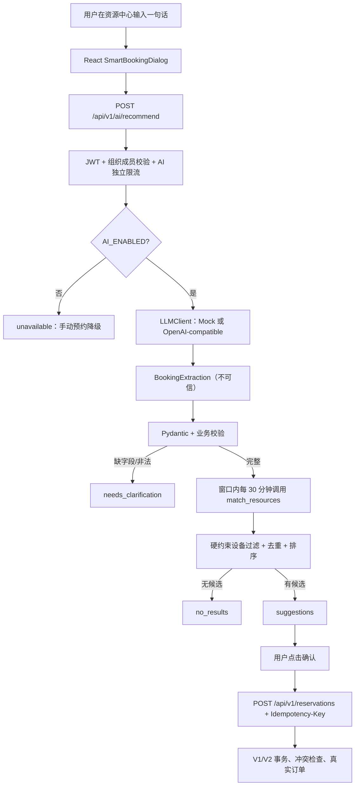

# V3 Lite 架构

## 模块

| 模块 | 职责 |
| --- | --- |
| `backend/app/ai/mock.py` | 确定性中文规则解析器，测试与本地演示 |
| `backend/app/ai/client.py` | Mock / OpenAI-compatible 客户端、超时、有限重试、错误归类 |
| `backend/app/ai/prompts.py` | 受控 JSON 提取 Prompt 与 JSON Schema |
| `backend/app/ai/schemas.py` | `BookingExtraction`、请求/响应模型 |
| `backend/app/ai/service.py` | 时区、日期/时长校验、时间窗口搜索、复用 V2 匹配 |
| `backend/app/api/routes/ai.py` | `POST /api/v1/ai/recommend`、JWT、限流 |
| `frontend/src/components/ai/SmartBookingDialog.tsx` | 输入、修正、推荐卡片、确认与冲突处理 |

## 为什么按 30 分钟编排

V2 `match_resources` 接收**一个确定的起止时段**，不会自动在“下午”这种宽窗口里搜索多个开始时间。V3 不重写调度算法，而是在窗口内每 30 分钟构造一个精确请求，合并结果：

- 单资源最多保留 2 个候选时段，整体最多 6 个。
- 评分、容量/场地/时段软偏好全部沿用 V2。
- 设备标签使用别名归一化（如“投影”“投屏” → “投影仪”），匹配真实资源 `features`。
- 推荐只读：不创建 `HOLD`、不写 `Reservation`；`ensure_range_slots` 可能物化时间片，但不占用。

## 时间与时区

- 指定 `site_id`：使用该场地 IANA 时区。
- 未指定且组织内启用场地时区一致：使用统一时区。
- 多时区且未选场地：返回 `needs_clarification`，缺失 `site_id`。
- “上午/下午/中午/傍晚/晚上”转换为明确搜索窗口；今天的时间窗口自动跳过 `BOOKING_MIN_LEAD_MINUTES`。
- 过去日期、超出 `BOOKING_WINDOW_DAYS`、跨日、非 30 分钟对齐、时长超限均拒绝。

## 安全不变量

1. `org_id` 来自请求但由服务端成员校验；`site_id` 必须属于当前组织。
2. LLM 输出不包含可执行身份/资源 ID，额外字段被忽略。
3. 资源容量、设备、地点、空闲状态只来自数据库。
4. 409 表示推荐后时段被占用，界面必须提示重新推荐，不能假报成功。
5. AI 关闭不影响 V1/V2 手动预约、候补、匹配与 Worker。

